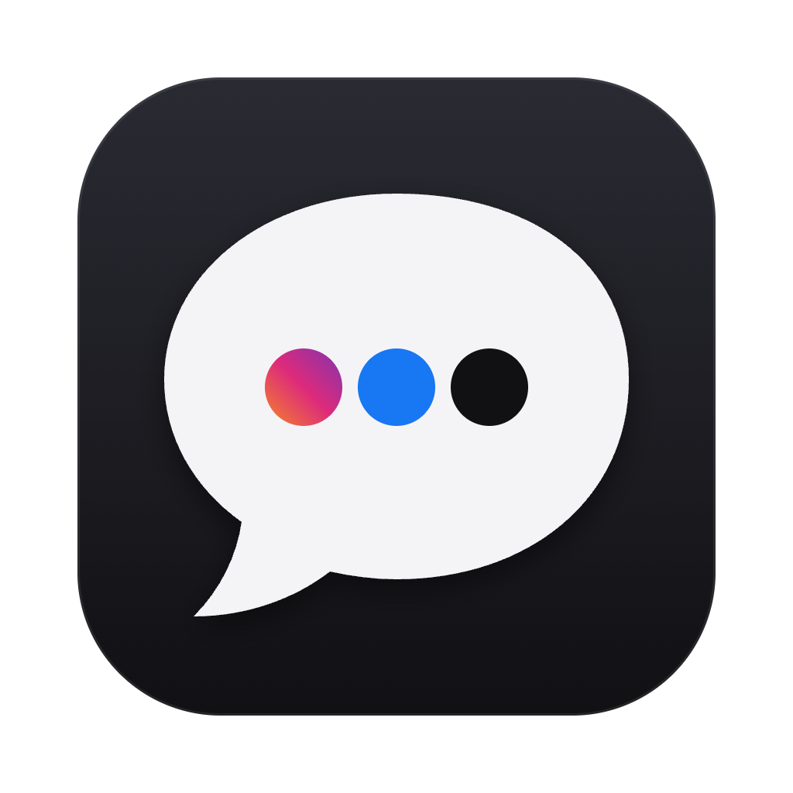

<p align="center">
  
</p>

<h1 align="center">Social Hub</h1>

<p align="center">
  Instagram, Facebook and X messages in one Mac app, without the feeds.<br>
  <a href="https://github.com/maciekstosio/social-hub/releases/latest"><b>Download the latest release</b></a>
</p>

---

Social Hub keeps the parts of social media you actually need, your conversations, and
leaves out the parts built to keep you scrolling. Each platform runs as its official web
app inside the hub, but only on an allowlist of pages: the inbox, chats, calls, login and
settings. The home feed, Reels, Explore, Marketplace and the rest are blocked, and their
buttons are hidden.

## What you get

**Instagram**: your DMs and calls. A shared post, reel or story opens in a locked viewer
that shows only that one item, with no swiping to the next. Close it (`Esc`) and you're
back in the chat.

**Facebook**: Messenger chats and calls. The top bar keeps only notifications and your
profile menu.

**X**: your DMs, plus a feed made only from a private X List of people you pick. No "For You", no
trends, no Explore. Optionally, only posts by specific friends are shown.

Links to other websites open in your normal browser. Links to social media stay in the hub
and follow the same rules.

## Install

1. Download `Social-Hub-<version>-arm64.dmg` from the
   [latest release](https://github.com/maciekstosio/social-hub/releases/latest)
   (Apple silicon Macs).
2. Open it and drag **Social Hub** to Applications.
3. Log in to each platform once. You stay logged in.

The app is signed and notarized by Apple. It updates itself: new versions download in the
background and install when you quit, or right away via **Social Hub → Restart to Install
Update**.

## Privacy

- Everything runs on your Mac. There is no Social Hub server and no analytics.
- Each platform gets its own separate browser session, so they can't see each other's cookies.
- Your logins are stored encrypted with your macOS Keychain.

Social Hub is not affiliated with Meta or X. It displays their regular websites, so a
redesign on their side can occasionally hide or block something it shouldn't, until the
hub is updated.

## Configure

Open **Social Hub → Settings… (⌘,)** to edit `config.json`, then use
**Social Hub → Restart (⇧⌘R)** to apply the changes.

```json
{
  "x": { "listId": "1234567890", "friends": ["alice", "bob"] },
  "instagram": { "viewerUseEmbed": false },
  "extraAllow": { "instagram": [], "facebook": [], "x": [] }
}
```

| Setting | What it does |
|---|---|
| `x.listId` | The ID of your private X List, the number in `x.com/i/lists/<id>`. The X tab opens on it. If it's empty, X opens on your messages. |
| `x.friends` | Handles, without `@`. If set, the list feed shows only these people's posts and hides everything else, including ads and suggestions. Empty means the whole list is shown. |
| `instagram.viewerUseEmbed` | Open shared Instagram posts in their minimal embed version (media only). Works for public posts only. |
| `extraAllow` | Extra URL patterns (regular expressions) to allow per platform, if a page you need gets blocked. |

If something you need is blocked, **Social Hub → Blocked Pages Log** shows every blocked
page with its address. That's the place to start when adding an `extraAllow` pattern or
reporting an [issue](https://github.com/maciekstosio/social-hub/issues). The log can
contain chat links, so check it before pasting it anywhere public.

## Keyboard shortcuts

| Keys | Action |
|---|---|
| `⌘1` / `⌘2` / `⌘3` | Switch to Instagram, Facebook or X. Selecting the current one again returns to its home. |
| `⌘L` | Open the link on your clipboard. You can also drop a link on the left edge of the window. |
| `Esc` or `⌘[` | Close a shared post, reel or story and return to the chat |
| `⌘R` | Reload the current platform |
| `⌘,` | Settings |
| `⇧⌘R` | Restart (installs a downloaded update) |

## Development

```sh
npm install
npm start          # run from source (no auto-updates, no cookie encryption)
npm test           # URL allowlist rules
npm run dist       # package the app into release/
```

How it's built and why: [SPEC.md](SPEC.md).

<details>
<summary>Releasing</summary>

- **Check** (`.github/workflows/check.yml`) runs typecheck and tests on every PR and push to `main`.
- **Release** (`.github/workflows/release.yml`) runs on every push to `main`. It builds a
  Developer ID signed, notarized app and publishes it as a GitHub Release (`v0.1.<run>`), which
  installed apps update to. Bump major/minor in `package.json` by hand.

Repository secrets:

| Secret | What |
|---|---|
| `CSC_LINK` | Developer ID Application certificate, `.p12` as base64 |
| `CSC_KEY_PASSWORD` | Its password |
| `APPLE_API_KEY` | App Store Connect API key, contents of `AuthKey_XXXX.p8` |
| `APPLE_API_KEY_ID` | Its key ID |
| `APPLE_API_ISSUER` | Its issuer ID |

</details>
